# expense_tracker

A new Flutter project.

## Getting Started

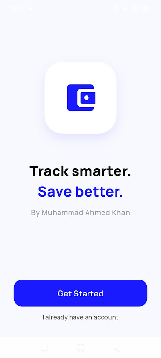
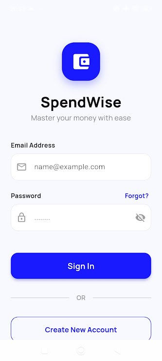
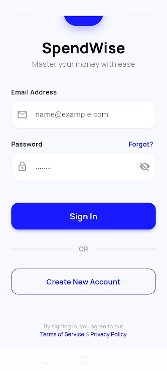
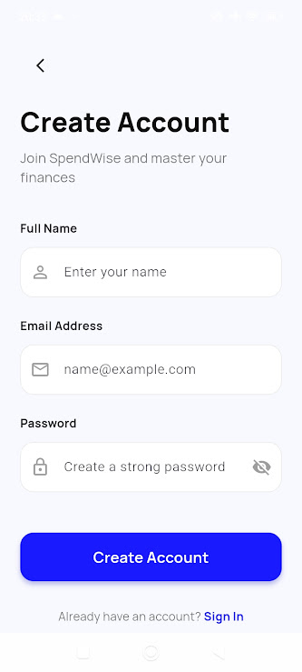
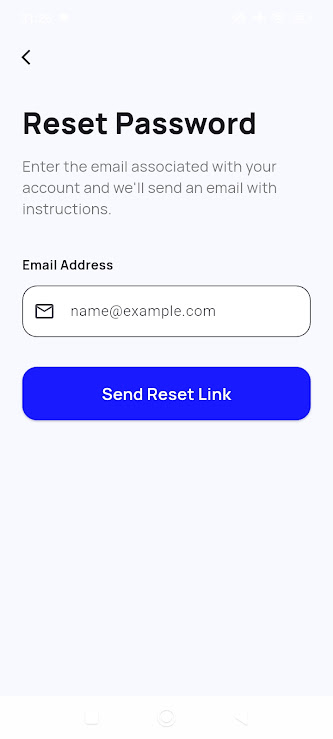
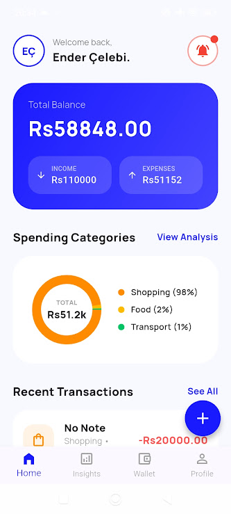
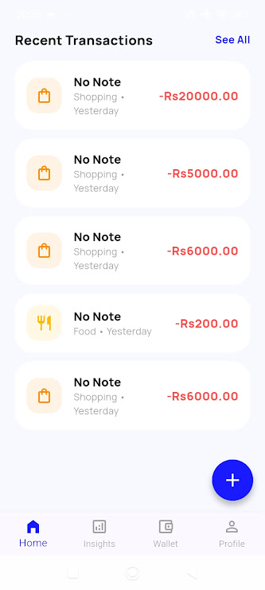
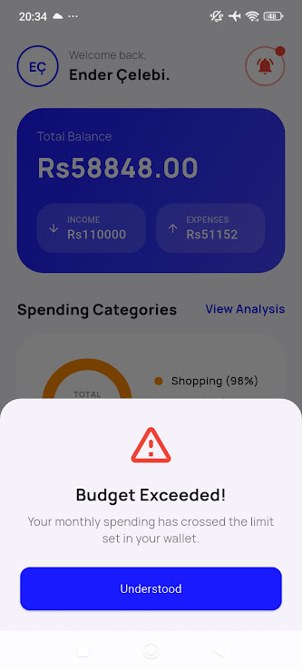
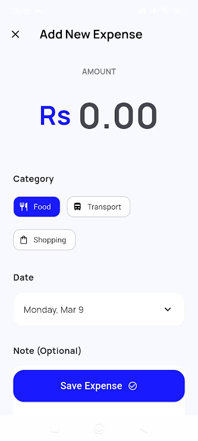
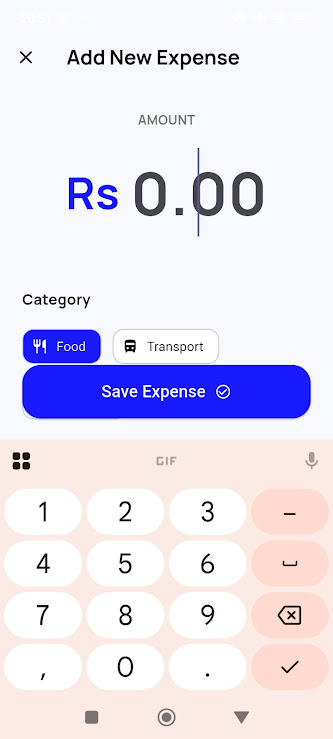
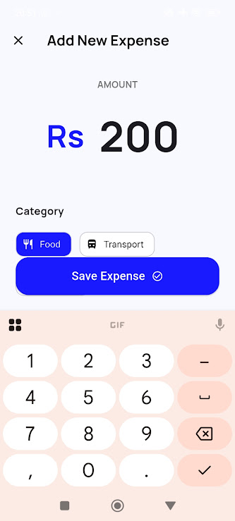
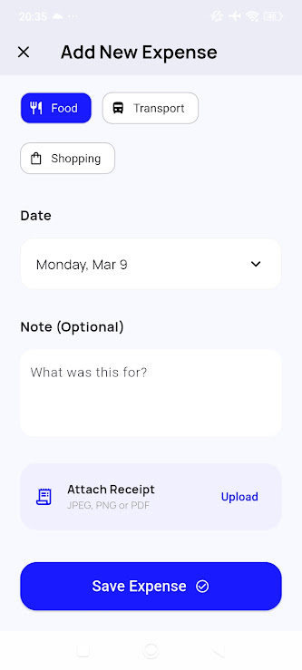
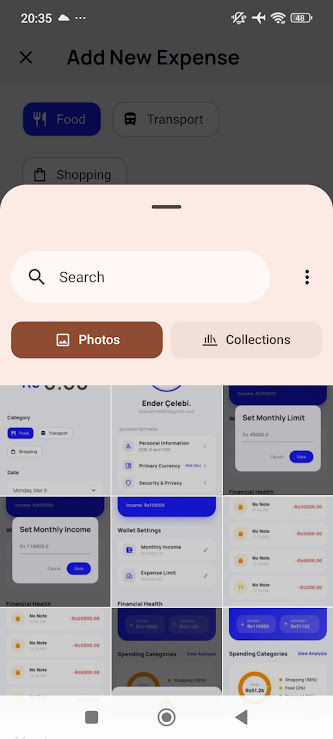
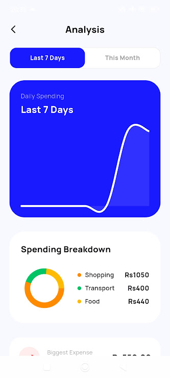
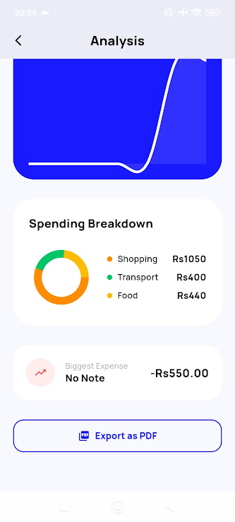
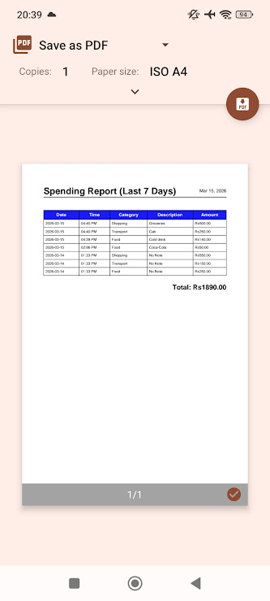
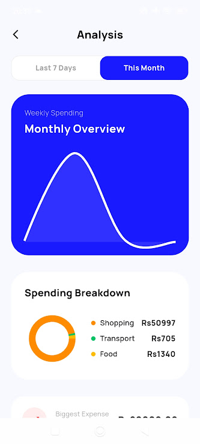

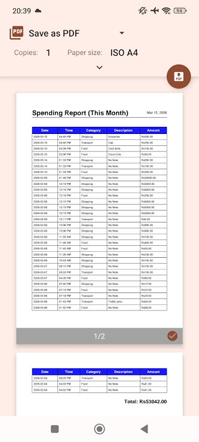
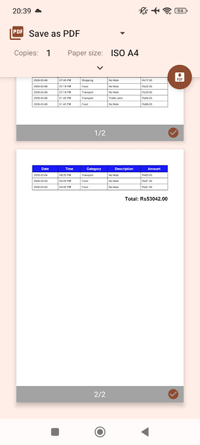
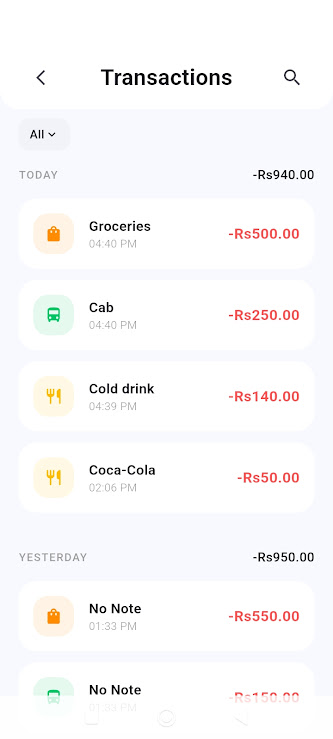
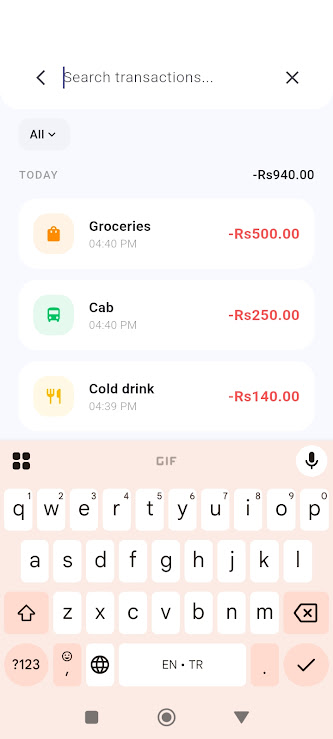
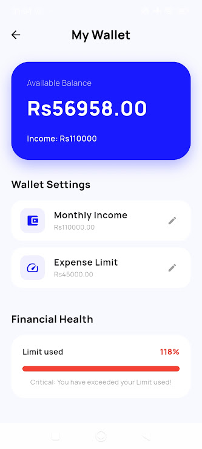
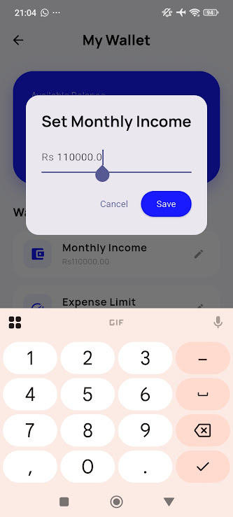
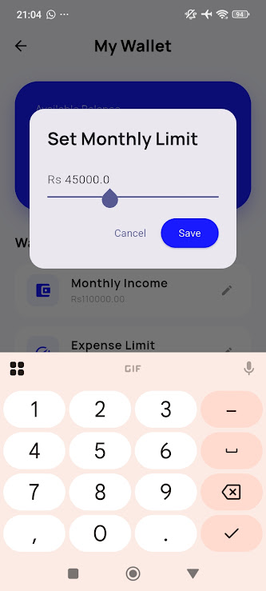
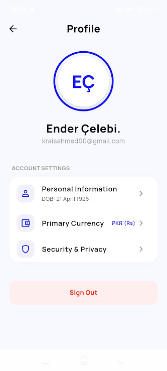

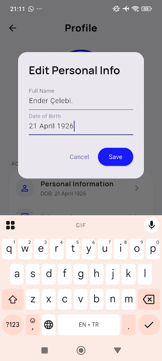
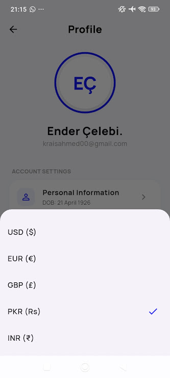

Developer: Muhammad Ahmed Khan

Built With: Flutter, Firebase (Authentication, Cloud Firestore, Firebase Storage), Material 3, fl_chart, and Google Fonts

Overview:

SpendWise is a full-featured personal finance and expense tracking mobile application designed to help users track spending, analyze personal budget habits, and maintain control over their financial health. Featuring a clean Royal Blue UI theme (#1A1AFF), the app seamlessly syncs expense data using Firebase Firestore and provides intuitive charts, customizable currency preferences, and PDF export capabilities.

Key Features:

User Authentication & Onboarding:

Onboarding Screen: Intro screen featuring clean branding ("Track smarter. Save better.") with custom buttons to register or log in.

User Authentication: Email & password authentication (Sign Up, Sign In, Sign Out) backed by Firebase Auth.

Password Reset: Self-service password recovery functionality via email.

Form Validation & Password Visibility Toggle: Includes interactive password hide/show functionality and error alerts.

Main Dashboard (Home):

Real-time Balance Summary: Displays total available balance, monthly income, and total calculated expenses dynamically.

User Personalization: Features user profile initials avatar and dynamic personalized welcome messaging.   

Spending Categories Summary: Includes a donut pie chart summarizing current expense distributions by percentage.   

Recent Activity Feed: Shows the most recent transactions with relative timestamps (e.g., "Just now", "Yesterday") and category icons.   

Budget Exceeded Alert System: Dynamic warning notification modal and pulsing alert icon triggered when spending exceeds the user-configured monthly budget limit.   

Expense Tracking & Management:

Add Expense Flow: Quick floating action button (+) to log new expenses.   

Flexible Fields: Select transaction amount, date picker, category, and custom notes.   

Predefined Categories: Supports core categories like Food, Transport, Shopping, and Income with custom icons and colors.   

Receipt Attachment: Integrated image_picker functionality allowing users to attach receipt photos or documents.   

Analytics & Reporting (Insights):

Time Range Toggles: Filter financial insights between Last 7 Days (Daily Spending) and This Month (Weekly Overview).   

Line Chart Spending Trends: Smooth curved visual representation of spending patterns powered by fl_chart.   

Category Breakdown & Top Expense: Detailed Breakdown list and "Biggest Expense" tile highlighting the user's largest purchase.   

PDF Report Generation & Export: Generate formatted A4 PDF reports summarizing transactions, descriptions, dates, and total spending with print/save functionality using the printing package.

Transaction History:

Grouped Activity View: Group transactions chronologically (Today, Yesterday, or specific dates).

Real-time Search: Search transactions instantly by note title or description.  

Category Filters: Filter history view by specific transaction categories.  

Wallet & Budget Management:

Income & Limit Configuration: Set custom monthly income and maximum expense spending limits.

Financial Health Progress Bar: Visual progress bar indicating percentage of budget used (safe, warning, or critical status).

Profile & Customization:

Personal Info Management: Edit name and date of birth.   

Multi-Currency Support: Choose from multiple currencies including USD ($), EUR (€), GBP (£), PKR (Rs), and INR (₹), which dynamically update across all screen balance representations.   

Privacy Policy Modal: Security and data safety disclaimer modal. 

dependencies:
  flutter: sdk
  firebase_core: ^3.1.1
  firebase_auth: ^5.1.2
  cloud_firestore: ^5.1.0
  firebase_storage: ^12.4.0
  fl_chart: ^0.69.0
  google_fonts: ^6.2.1
  intl: ^0.19.0
  provider: ^6.1.2
  flutter_lucide: ^1.8.2
  image_picker: ^1.0.7
  pie_chart: ^5.4.0
  pdf: ^3.11.1
  printing: ^5.11.1
  rxdart: ^0.27.7

  ## 📁 Project Architecture

  lib/
├── main.dart                       # Entry point & app initialization
├── firebase_options.dart           # Auto-generated Firebase configurations
├── auth_service.dart               # Firebase Authentication helper logic
├── database_service.dart           # Firestore transactions & user data logic
├── transaction_model.dart          # Transaction data model
├── onboardinglogo_screen.dart     # Welcome / Logo landing page
├── login_screen.dart              # User sign-in interface
├── signup_screen.dart             # New user registration screen
├── forgot_password_screen.dart    # Password recovery screen
├── home_screen.dart               # Main dashboard with summaries & FAB
├── add_expense_screen.dart        # New transaction logging modal
├── view_analysis_screen.dart      # Spending analytics & PDF exporter
├── transaction_history_screen.dart # Searchable and filterable history
├── wallet_screen.dart             # Income, limit & financial health management
└── profile_screen.dart            # User profile, currency picker & sign-out
